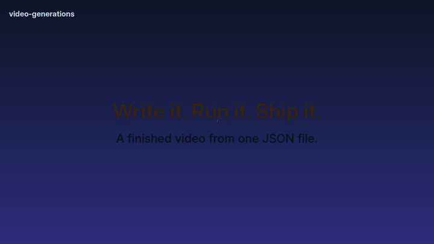
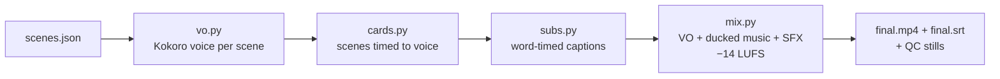

<div align="center">

# 🎬 video-generations

### Turn a few lines of JSON into a finished, voiced, captioned video — offline, on any laptop.

[](https://github.com/Sanjayyykumar/video-generations/actions/workflows/smoke.yml)




<sub>☝️ This whole clip — voice, timing, cards and mix — came from <a href="examples/hello-studio/scenes.json">one 30-line JSON file</a>. <a href="docs/demo.mp4">Watch it with sound</a>.</sub>

</div>

---

## Why you'll like it

- **One command.** `make.py` voices every scene, times the visuals to the voice, renders, adds captions, mixes and runs QC.
- **Real voices, no cloud.** [Kokoro](https://huggingface.co/hexgrad/Kokoro-82M) TTS runs locally: 50+ voices, voice blending, English, Hindi and more. No API key, no per-minute bill.
- **No GPU.** Pure Python + FFmpeg. A 20-second video takes about a minute on an ordinary laptop.
- **Sounds produced, not generated.** Music ducks under speech, loudness is normalised to −14 LUFS (YouTube/Instagram), captions are word-timed.
- **Bring your own visuals.** Render `src/silent.mp4` with Remotion, Manim, HyperFrames, After Effects… and let the studio add voice, captions and the mix.
- **Built for AI agents too.** Small, readable scripts with clear contracts, so Claude, Cursor or Copilot can drive it end to end.

## Quick start (5 minutes)

```bash
git clone https://github.com/Sanjayyykumar/video-generations
cd video-generations
pip install -r requirements.txt          # also install FFmpeg: winget / brew / apt install ffmpeg
python studio/get_models.py              # ~120 MB voice model, once
python studio/doctor.py                  # checks everything, prints READY  (yt-dlp optional: winget/brew install yt-dlp)
python studio/make.py examples/hello-studio
```

Open `examples/hello-studio/out/final.mp4` 🎉

## Make your own

```bash
python studio/new_project.py "why honey never spoils" --format 9:16 --length 30
# edit projects/<date>_why-honey-never-spoils/scenes.json
python studio/make.py projects/<date>_why-honey-never-spoils --music audio/music/bed.mp3
```

A scene is just what to show and what to say:

```json
{
  "voice": "af_heart",
  "scenes": [
    { "title": "Honey never spoils", "body": "3,000-year-old honey is still edible.", "say": "Archaeologists found honey in Egyptian tombs, and it was still edible." },
    { "title": "Why?", "body": "Low water. High acid. Natural peroxide.", "say": "The secret is chemistry: almost no water, lots of acid, and a little natural peroxide.", "image": "jar.png" }
  ]
}
```

| Field | Meaning |
|---|---|
| `title`, `body` | On-screen text (animated in) |
| `say` | The voice line. The scene stretches to fit it. |
| `image` | Optional picture from the project's `assets/` |
| `bg`, `accent` | Gradient colours and accent bar, per scene or global |
| `sfx` | `[{"file": "audio/sfx/whoosh.mp3", "at": 0.2, "vol": 0.5}]` |
| `voice` | Global or per scene, e.g. `"hf_alpha"` or a blend `"af_heart:0.6,bf_emma:0.4"` |
| `speed`, `lang` | Global, e.g. `"speed": 1.05`, `"lang": "hi"` for Hindi |

Formats: `9:16` (Reels/Shorts/TikTok), `16:9` (YouTube), `1:1` (feed).

## Edit your own reels (talking head → finished reel)

```bash
python studio/reel.py raw.mp4 reel.mp4 --music bed.mp3
```
Silences cut out (tight jump cuts) · punch-in zoom on every 2nd cut · reframed to 9:16 · colour grade · **word-by-word captions** with the active word highlighted and key words (numbers, long words) emphasised · music ducked under your voice · −14 LUFS.

## Copy the *feel* of reels you love (not the content)

```bash
python studio/reference.py projects/my-style <link1> <link2> <link3>
```
Downloads the references (yt-dlp) and measures them in code: cut pace, cuts in the first 3 s, silence left in, words per second, loudness, grade and palette. You get contact sheets of the hook and every shot, a `STYLE.md` brand sheet to review, and a `style.draft.json` that `reel.py --style` applies.

## How it works



Each step is a small script you can run on its own (`python studio/<step>.py <project>`).

## Voices

| | Voices |
|---|---|
| 🇺🇸 American | `af_heart` ⭐, `af_bella`, `af_nicole`, `af_kore`, `am_michael`, `am_onyx` |
| 🇬🇧 British | `bf_emma`, `bm_george` |
| 🇮🇳 Indian English / Hindi | `hf_alpha`, `hf_beta`, `hm_omega`, `hm_psi` (`"lang": "hi"` for Hindi) |
| 🎛️ Blend | `"af_heart:0.6,bf_emma:0.4"` — mix any two or more |

Fix any mispronunciation once in [`voice/lexicon.py`](voice/lexicon.py).

## Going further

| You want… | Use |
|---|---|
| A long, directed narration with breaths and pauses | [`voice/`](voice/README.md): `speak.py` → `polish_vo.py` → `mix_narration.py` |
| Dialogue with several characters | `voice/speak_cast.py` |
| A premium cloud voice without paying twice | `voice/el_cache.py` (ElevenLabs, cached per line) |
| Reels in a style you defined | `studio/reference.py` → review `STYLE.md` → `studio/reel.py --style style.json` |
| Fancier visuals (React, math, motion graphics) | Render `src/silent.mp4` with Remotion / Manim / HyperFrames, then `make.py <project> --skip-render` |
| Narration that sounds like a presenter | [`docs/voice-house-style.md`](docs/voice-house-style.md) |

## Project layout

```
video-generations/
├── studio/            pipeline (new_project · vo · cards · subs · mix · make) + reel · reference · captions · doctor · get_models
├── voice/             directed narration tools + examples/
├── templates/         scenes.json, STORYBOARD, LOG, SOURCES copied into every new project
├── examples/          hello-studio (the demo above)
├── assets/fonts/      Inter (OFL) so text looks identical on every OS
├── docs/              demo + voice style guide
├── models/            downloaded voice/caption models   (git-ignored)
└── projects/          your videos                       (git-ignored)
```

## Requirements

Python 3.10+, FFmpeg on PATH. Windows, macOS and Linux. Captions need `faster-whisper` (in `requirements.txt`; the model downloads on first use, or `python studio/get_models.py --captions`).

## Roadmap

- [ ] Ken Burns pan/zoom for images
- [ ] Background-music picker with automatic licence log
- [ ] Caption styles (karaoke highlight, emoji)
- [ ] Web UI for editing scenes

Ideas and PRs are welcome — open an issue with what you want to make.

## Credits

Built by [Sanjay Kumar](https://github.com/Sanjayyykumar). Stands on [Kokoro](https://huggingface.co/hexgrad/Kokoro-82M), [kokoro-onnx](https://github.com/thewh1teagle/kokoro-onnx), [faster-whisper](https://github.com/SYSTRAN/faster-whisper), [FFmpeg](https://ffmpeg.org) and the [Inter](https://github.com/rsms/inter) typeface — see [THIRD_PARTY_NOTICES.md](THIRD_PARTY_NOTICES.md).

Companion repo: [**ai-essentials**](https://github.com/Sanjayyykumar/ai-essentials) — the agent playbooks and skills that drive this studio.

**MIT licensed.** If this saved you an afternoon, a ⭐ helps others find it.
